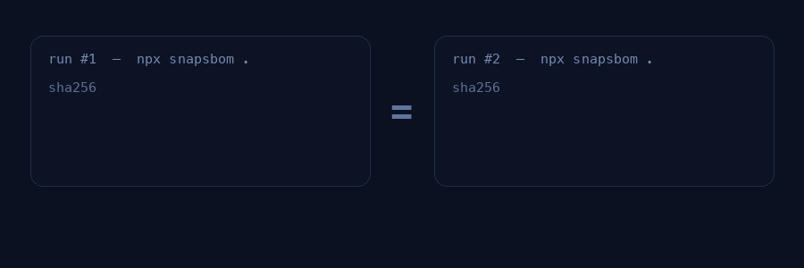

<div align="center">
  
</div>

<br/>

<div align="center">

[](https://www.npmjs.com/package/snapsbom)
[](https://www.npmjs.com/package/snapsbom)
[](https://github.com/kawacukennedy/snapsbom/actions)
[](./LICENSE)
[](./CONTRIBUTING.md)
[](https://www.rust-lang.org/)

</div>

<div align="center">
  <h3>Deterministic SBOMs in milliseconds.</h3>
  <p>
    SnapSBOM turns your lockfiles into <b>SPDX&nbsp;2.3</b> and <b>CycloneDX&nbsp;1.6</b> Software Bills of Materials —<br/>
    entirely on your machine, with <b>zero network calls</b> and <b>byte-for-byte reproducible</b> output.
  </p>
  <p>
    <a href="https://kawacukennedy.github.io/snapsbom/"><b>Live demo</b></a> &nbsp;·&nbsp;
    <a href="#quick-start">Quick start</a> &nbsp;·&nbsp;
    <a href="#determinism">Why determinism</a> &nbsp;·&nbsp;
    <a href="#cli-reference">CLI reference</a> &nbsp;·&nbsp;
    <a href="https://www.npmjs.com/package/snapsbom">npm</a>
  </p>
</div>

<div align="center">
  
</div>

<br/>

---

## What is SnapSBOM?

[SBOMs](https://www.cisa.gov/sbom) are becoming mandatory — the **EU Cyber Resilience Act**, US executive orders, and enterprise procurement all expect them. Yet most SBOM tools are heavyweight scanners that require a build, a container, or a cloud upload, and that emit *different output every run*.

SnapSBOM takes the opposite approach. It **reads your lockfile directly** and emits a standards-compliant SBOM in a few milliseconds, using a canonical, sorted, timestamp-pinned representation so the same input always produces **exactly the same bytes**.

```console
$ npx snapsbom .
✔ Wrote SPDX 2.3 · 7 components · 3 ms
```

> **Same lockfile in, same bytes out — on any machine, any day.** That is what makes an SBOM *verifiable* instead of merely *present*.

---

<a id="quick-start"></a>
## ⚡ Quick start

No install required:

```bash
npx snapsbom .
```

Prefer a persistent install?

```bash
# Global npm install
npm install -g snapsbom
snapsbom .

# …or build the CLI from source
cargo install --path .   # after cloning this repo
```

Point it at a directory (it finds `package-lock.json` automatically) or straight at a lockfile:

```bash
snapsbom ./my-app
snapsbom ./my-app/package-lock.json
```

---

## ✨ Features

| | |
|---|---|
| **🎯 Deterministic by design** | Fixed timestamps, sorted keys, canonical package IDs and ordering. Identical input → identical bytes, forever. |
| **🔒 Truly local-first** | Zero network calls. Zero telemetry. Runs offline, in CI, and in air-gapped environments. |
| **⚙️ One core, two runtimes** | The same Rust core powers the CLI and the browser (WASM) playground — so both agree exactly. |
| **📦 Standards compliant** | Emits [SPDX 2.3](https://spdx.github.io/spdx-spec/v2.3/) and [CycloneDX 1.6](https://cyclonedx.org/specification/overview/) JSON. |
| **🚀 Fast & dependency-light** | Parses lockfiles directly — no source scan, no container, no Docker. Milliseconds, not minutes. |
| **🧩 Tiny surface** | A single static binary (or a `npx` one-liner). Nothing to configure to get a valid SBOM. |

---

<a id="determinism"></a>
## 🔬 Why determinism matters

A normal SBOM generator stamps the current time, walks the filesystem in an arbitrary order, and assigns random IDs. Run it twice and you get two different files — so you cannot tell whether a change in the diff is a **real dependency change** or just noise. That makes review, diffing, and attestation painful.

SnapSBOM produces a **canonical** document instead:

- 🕒 `created` is pinned to a fixed epoch (`2026-01-01T00:00:00Z`), not “now”.
- 🔢 Packages are **deduplicated by purl and sorted**, so `SPDXRef-Package-1…N` are stable and predictable.
- 🔑 Keys are emitted in a stable order, so line-level diffs are meaningful.
- 🧾 The `documentNamespace` is stable, so the document identity doesn’t churn.

The result: you can commit an SBOM next to the lockfile and **`git diff` it like any other file**. Verification becomes a string comparison.

<div align="center">
  
</div>

```bash
$ snapsbom examples/demo | sha256sum
ff8584cdc321a348c94c9d8e139149556ab8b895d8b83da68e41013fe38c7689  -

$ snapsbom examples/demo | sha256sum   # …and again
ff8584cdc321a348c94c9d8e139149556ab8b895d8b83da68e41013fe38c7689  -
```

---

## 📤 Output formats

### SPDX 2.3 (default)

```bash
snapsbom . --format spdx
```

<details>
<summary>See sample output</summary>

```json
{
  "SPDXID": "SPDXRef-DOCUMENT",
  "spdxVersion": "SPDX-2.3",
  "dataLicense": "CC0-1.0",
  "name": "SnapSBOM SBOM",
  "documentNamespace": "https://spdx.org/spdxdocs/SPDXRef-DOCUMENT-STATIC",
  "creationInfo": {
    "created": "2026-01-01T00:00:00Z",
    "creators": ["Tool: SnapSBOM"]
  },
  "packages": [
    {
      "SPDXID": "SPDXRef-Package-1",
      "name": "@types/node",
      "versionInfo": "22.10.2",
      "downloadLocation": "NOASSERTION",
      "filesAnalyzed": false,
      "licenseConcluded": "NOASSERTION",
      "licenseDeclared": "NOASSERTION",
      "copyrightText": "NOASSERTION",
      "supplier": "NOASSERTION",
      "externalRefs": [
        {
          "referenceCategory": "PACKAGE-MANAGER",
          "referenceType": "purl",
          "referenceLocator": "pkg:npm/%40types/node@22.10.2"
        }
      ]
    }
  ],
  "relationships": [
    {
      "spdxElementId": "SPDXRef-DOCUMENT",
      "relationshipType": "DESCRIBES",
      "relatedSpdxElement": "SPDXRef-Package-1"
    }
  ]
}
```

</details>

### CycloneDX 1.6

```bash
snapsbom . --format cyclonedx
```

<details>
<summary>See sample output</summary>

```json
{
  "bomFormat": "CycloneDX",
  "specVersion": "1.6",
  "version": 1,
  "components": [
    {
      "type": "library",
      "name": "@types/node",
      "version": "22.10.2",
      "purl": "pkg:npm/%40types/node@22.10.2",
      "supplier": { "name": "NOASSERTION" },
      "licenses": []
    }
  ]
}
```

</details>

---

<a id="cli-reference"></a>
## 🧰 CLI reference

```text
Deterministic SBOM generator

Usage: snapsbom [OPTIONS] <PATH>

Arguments:
  <PATH>  Path to lockfile (e.g. package-lock.json) or directory

Options:
      --format <FORMAT>  [default: spdx] [possible values: spdx, cyclonedx]
      --output <OUTPUT>  Output file (stdout if not specified)
  -h, --help             Print help
  -V, --version          Print version
```

| Command | What it does |
|---|---|
| `snapsbom .` | Generate SPDX from `package-lock.json` in the current directory. |
| `snapsbom . --format cyclonedx` | Generate a CycloneDX 1.6 document. |
| `snapsbom . --output sbom.spdx.json` | Write to a file instead of stdout. |
| `snapsbom path/to/package-lock.json` | Analyze a specific lockfile. |

---

## 🗂️ Supported inputs

| Ecosystem | Lockfile | Status |
|---|---|---|
| **npm** | `package-lock.json` (v2 / v3) | ✅ Supported |
| pnpm | `pnpm-lock.yaml` | 🛣️ Roadmap |
| Yarn | `yarn.lock` | 🛣️ Roadmap |
| Python | `poetry.lock`, `requirements.txt` | 🛣️ Roadmap |
| Cargo | `Cargo.lock` | 🛣️ Roadmap |

SnapSBOM is intentionally **honest about scope**: it currently guarantees correctness for npm lockfiles, and grows one ecosystem at a time. PRs for new parsers are very welcome — the parser plug-in point lives in [`src/npm.rs`](./src/npm.rs).

---

## 🏗️ How it works

```
        package-lock.json
               │
               ▼
      ┌───────────────────┐
      │  Parser (npm)     │  read lockfile → component set
      └───────────────────┘
               │
               ▼
      ┌───────────────────┐
      │  Canonicalise     │  dedupe by purl · sort · pin IDs
      └───────────────────┘
               │
               ▼
      ┌───────────────────┐
      │  Emitter          │  SPDX 2.3  |  CycloneDX 1.6
      └───────────────────┘
               │
               ▼
          SBOM (stdout / file)
```

One Rust crate (`snapsbom`) provides the parser, the deterministic canonicaliser, and both emitters. It's compiled twice:

- as a **CLI** (`src/main.rs`, via `clap`) — the binary you run with `npx` or `cargo`;
- as a **WASM module** (`src/wasm.rs`, via `wasm-bindgen`) — used by the [browser demo](https://kawacukennedy.github.io/snapsbom/), where everything runs client-side.

Because both share the same core, the browser and the terminal produce identical documents.

---

## 🔄 Use it in CI

Generate an SBOM as a build artifact — no secrets, no network, no external service:

```yaml
name: SBOM
on:
  push:
    branches: [main]

jobs:
  sbom:
    runs-on: ubuntu-latest
    steps:
      - uses: actions/checkout@v4
      - uses: actions/setup-node@v4
        with:
          node-version: 20
      - name: Generate SBOM
        run: npx --yes snapsbom . --format cyclonedx --output sbom.cdx.json
      - uses: actions/upload-artifact@v4
        with:
          name: sbom
          path: sbom.cdx.json
```

---

## 🤝 Contributing

Contributions are welcome — new lockfile parsers, emitter tweaks, docs, and tests especially.

- Read [`CONTRIBUTING.md`](./CONTRIBUTING.md) to get started.
- Run `cargo test` before opening a PR.
- See [`CODE_OF_CONDUCT.md`](./CODE_OF_CONDUCT.md) for community expectations.
- Found a security issue? Please follow [`SECURITY.md`](./SECURITY.md).

---

## 📄 License

MIT — see [`LICENSE`](./LICENSE).

<div align="center">
  <sub>Built with 🦀 Rust. No cloud. No telemetry. No nonsense.</sub>
</div>
