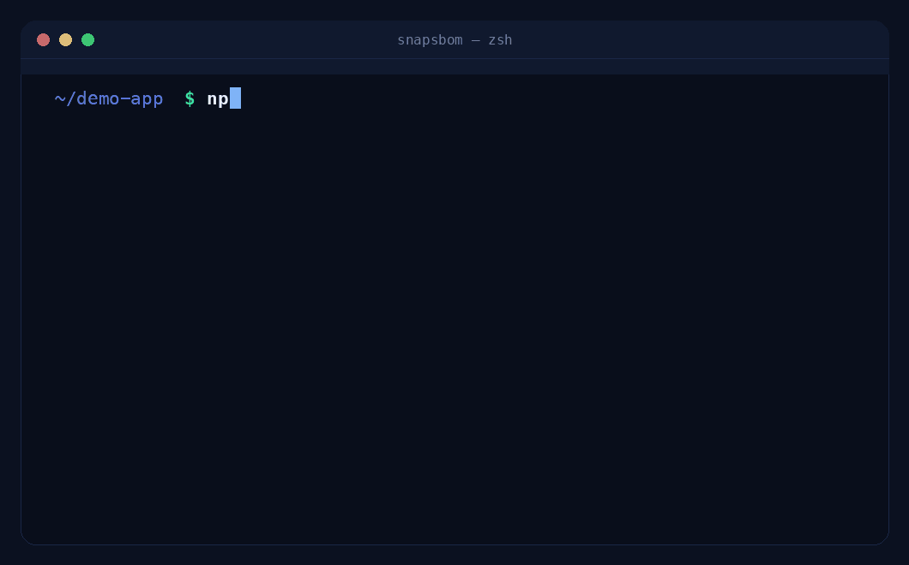

# SnapSBOM

<p align="center">
  
</p>

<h1 align="center">SnapSBOM</h1>

<p align="center">
  <strong>Deterministic SBOM generation. Same input. Same output. Every time.</strong>
</p>

<p align="center">
  <a href="https://www.npmjs.com/package/snapsbom"></a>
  <a href="https://crates.io/crates/snapsbom"></a>
  <a href="https://github.com/kawacukennedy/snapsbom/releases"></a>
  <a href="https://github.com/kawacukennedy/snapsbom/actions/workflows/ci.yml"></a>
  <a href="https://opensource.org/licenses/MIT"></a>
</p>

<p align="center">
  <a href="https://kawacukennedy.github.io/snapsbom/">Live Demo</a> •
  <a href="https://github.com/kawacukennedy/snapsbom/blob/main/README.md#quick-start">Quick Start</a> •
  <a href="https://www.npmjs.com/package/snapsbom">npm</a> •
  <a href="https://github.com/kawacukennedy/snapsbom/releases">Releases</a>
</p>

---

SnapSBOM generates deterministic [SBOMs](https://www.cisa.gov/resources-tools/resources/software-bill-materials-sbom) (Software Bill of Materials) in milliseconds. Built for speed, correctness, and trust, it runs entirely locally with zero network calls and zero telemetry.

<p align="center">
  
</p>

## Why SnapSBOM

- **Deterministic by design** — Same input produces byte-for-byte identical output across platforms, runtimes, and time.
- **Local-first & private** — No network calls, no telemetry, no tracking. Works offline and in air-gapped environments.
- **Run anywhere** — Identical logic in CLI, npx, and browser (WASM). One codebase. One truth.
- **Standards compliant** — Generate [SPDX 2.3](https://spdx.github.io/spdx-spec/v2.3/) or [CycloneDX 1.6](https://cyclonedx.org/specification/overview/) SBOMs.
- **Blazing fast & minimal** — Parses lockfiles directly. No heavy filesystem scanning, no Docker dependencies.
- **Built for compliance** — Reproducible output makes verification, auditing, and compliance (including [EU CRA](https://digital-strategy.ec.europa.eu/en/library/cyber-resilience-act)) effortless.

## Quick Start

### Run instantly with npx

```bash
npx snapsbom .
```

### Install globally

```bash
npm install -g snapsbom
snapsbom .
```

### Download binary

Prebuilt binaries are available on [GitHub Releases](https://github.com/kawacukennedy/snapsbom/releases).

### Build from source

```bash
cargo install --git https://github.com/kawacukennedy/snapsbom
snapsbom .
```

## Usage

```bash
# Generate SPDX 2.3 (default)
snapsbom .

# Generate CycloneDX 1.6
snapsbom . --format cyclonedx

# Target specific lockfile or directory
snapsbom package-lock.json

# Write to file
snapsbom . --output sbom.spdx.json
```

## How It Works

SnapSBOM reads your existing lockfiles (`package-lock.json`, `pnpm-lock.yaml`, `yarn.lock`, `go.mod`/`go.sum`, `poetry.lock`), normalizes dependencies deterministically, and emits standards-compliant SBOMs with canonical ordering. The Rust core is shared between CLI and WASM, guaranteeing identical behavior everywhere.

## Contributing

We welcome contributions! Read our [Contributing Guide](./CONTRIBUTING.md) to get started.

## License

Licensed under the [MIT License](./LICENSE).

## Acknowledgments

Built with Rust and a focus on correctness, simplicity, and developer experience.
